### Laboratorio 2.

## 1. Cuadro Comparativo

Los robots industriales **Motoman MH6**, fabricado por Yaskawa, y **IRB 140**, fabricado por ABB, son manipuladores seriales antropomórficos de seis grados de libertad. Ambos están diseñados para aplicaciones de automatización industrial, aunque presentan diferencias importantes en alcance, velocidad, precisión y dimensiones.

### Características técnicas generales

| Característica | Yaskawa Motoman MH6 | ABB IRB 140 |
|---|---|---|
| Fabricante | Yaskawa Motoman | ABB Robotics |
| Modelo | MH6 | IRB 140-6/0.8 |
| Tipo de robot | Manipulador industrial articulado | Manipulador industrial articulado |
| Configuración mecánica | Antropomórfica, 6 ejes rotacionales | Antropomórfica, 6 ejes rotacionales |
| Grados de libertad (GDL) | 6 | 6 |
| Carga útil máxima | 6 kg | 6 kg |
| Alcance horizontal máximo | 1422 mm | 810 mm |
| Alcance vertical máximo | 2486 mm | Depende de la configuración articular |
| Repetibilidad de posicionamiento | ±0.08 mm | ±0.03 mm |
| Peso aproximado del manipulador | 130 kg | 98 kg|
| Sistema de accionamiento | Servomotores eléctricos de CA | Servomotores eléctricos de CA |
| Tipo de articulaciones | 6 articulaciones rotacionales, más 2 ejes externos | 6 articulaciones rotacionales |
| Controlador | Motoman DX100 | ABB IRC5 |
| Lenguaje de programación | INFORM | RAPID |
| Interfaz de programación | Teach Pendant Motoman | FlexPendant ABB |
| Simulador asociado | MotoSim EG-VRC | RobotStudio |
| Montaje | Suelo, invertido e inclinado | Suelo, pared e invertido |
| Aplicaciones típicas | Manipulación, soldadura, ensamblaje, empaquetado, alimentación de máquinas y dosificación | Manipulación, ensamblaje, soldadura, aplicación de adhesivos y operaciones de precisión |

### Velocidades articulares máximas

Las velocidades se expresan en grados por segundo (°/s). Cada valor corresponde a la velocidad máxima de una articulación individual.

| Articulación | Motoman MH6 | ABB IRB 140 |
|---|---|---|
| Eje 1: Rotación de base | 220 °/s | 200 °/s |
| Eje 2: Hombro | 200 °/s | 200 °/s |
| Eje 3: Codo | 220 °/s | 260 °/s |
| Eje 4: Rotación de muñeca | 410 °/s | 360 °/s |
| Eje 5: Inclinación de muñeca | 410 °/s | 360 °/s |
| Eje 6: Rotación final | 610 °/s | 450 °/s |

**Nota:** Las velocidades articulares máximas no equivalen a la velocidad cartesiana del TCP. La velocidad real del efector final depende de la configuración cinemática, las articulaciones involucradas y las restricciones del controlador.

### Rangos de movimiento articular

| Articulación | Motoman MH6 | ABB IRB 140 |
|---|---|---|
| Eje 1 | -170° a +170° | Recorrido total de 360° |
| Eje 2 | -90° a +155° | Recorrido total de 200° |
| Eje 3 | -175° a +250° | Recorrido total de 280° |
| Eje 4 | -180° a +180° | Rotación continua; límite configurable |
| Eje 5 | -45° a +225° | Recorrido total de 230° |
| Eje 6 | -360° a +360° | Rotación continua; límite configurable |

**Nota:** Los rangos del ABB se presentan como recorridos angulares totales cuando corresponde, no como límites simétricos respecto a cero. Los límites efectivos dependen de la versión y configuración del robot.

### Sistemas de control y programación

| Característica | Motoman MH6 | ABB IRB 140 |
|---|---|---|
| Controlador considerado | DX100 | IRC5 |
| Lenguaje nativo | INFORM | RAPID |
| Programación manual | Teach Pendant | FlexPendant |
| Movimiento articular | MOVJ | MoveAbsJ / MoveJ |
| Movimiento lineal | MOVL | MoveL |
| Movimiento circular | MOVC | MoveC |
| Gestión de entradas y salidas | Instrucciones INFORM y configuración de I/O | Instrucciones RAPID y configuración de I/O |
| Integración con sensores | Mediante interfaces y módulos compatibles | Mediante interfaces y módulos compatibles |
| Simulación y programación offline | MotoSim, RoboDK | RobotStudio, RoboDK |

## 2. Configuraciones Home

El manipulador industrial **Motoman MH6** cuenta con dos configuraciones de referencia: la posición inicial (*Home Position*) y la posición de transporte (*Transporting Position*), denominadas **Home1 y Home2**, respectivamente, dentro del laboratorio.

### Configuración Home1 – Posición inicial

La configuración **Home1** corresponde a la posición de referencia del manipulador, en la cual sus seis articulaciones presentan un desplazamiento angular de 0° respecto a sus respectivas referencias articulares.

Esta configuración permite establecer una postura conocida y reproducible del robot, útil para las operaciones de inspección y mantenimiento indicadas por el fabricante.

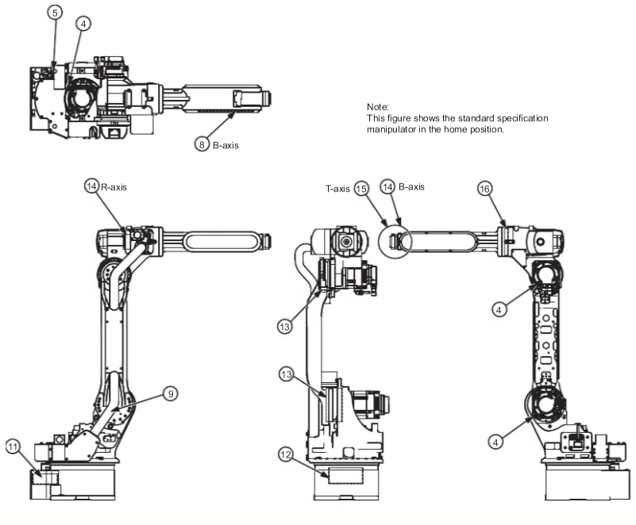

### Configuración Home2 – Posición de transporte

La configuración **Home2** tiene como propósito reducir el volumen ocupado por el manipulador mediante el plegado de sus eslabones, facilitando su transporte y almacenamiento.

Aunque los valores articulares de esta configuración no se especifican explícitamente en la documentación técnica consultada, fue posible obtener una aproximación mediante el software **RoboDK**, tomando como referencia las ilustraciones proporcionadas por el fabricante.

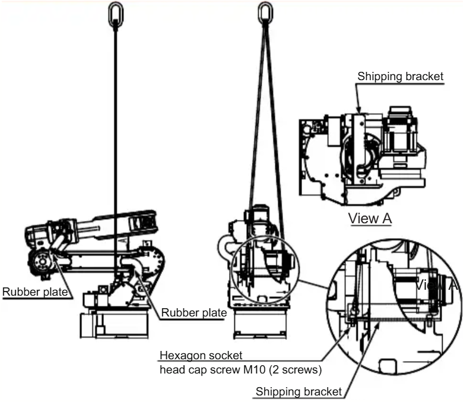

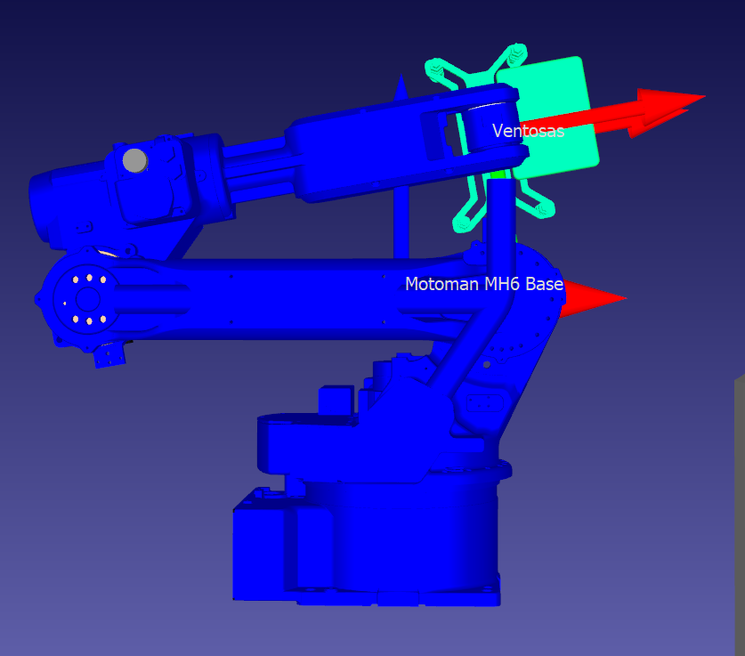

### Comparación de las posiciones articulares

| Articulación | Home1 | Home2 (aproximada) |
|:---:|:---:|:---:|
| θ₁ (S) | 0° | 0° |
| θ₂ (L) | 0° | -90° |
| θ₃ (U) | 0° | -80° |
| θ₄ (R) | 0° | -90° |
| θ₅ (B) | 0° | 0° |
| θ₆ (T) | 0° | 0° |

### ¿Cuál de las dos configuraciones es mejor?

No es posible establecer que una configuración sea universalmente superior a la otra, dado que ambas responden a necesidades operativas diferentes.

- **Home1:** resulta más conveniente como posición de referencia para las actividades de inspección, mantenimiento y verificación de las articulaciones.
- **Home2:** ofrece ventajas para el transporte y almacenamiento, al permitir una disposición más compacta del manipulador.

Por lo tanto, **la selección de la configuración más adecuada depende de la actividad que se desea realizar** y no exclusivamente de su disposición geométrica.

Además, ninguna de estas posiciones garantiza por sí sola la ausencia de colisiones o la seguridad de una trayectoria, aspectos que deben evaluarse según las condiciones del entorno de trabajo.

> **Nota:** Los valores articulares de Home2 son aproximaciones obtenidas mediante RoboDK y no corresponden a valores oficiales proporcionados por el fabricante.

## 3. Tipos de Movimiento

El manipulador industrial Motoman MH6 dispone de seis grados de libertad y puede controlarse manualmente mediante el Teach Pendant DX100. Este dispositivo permite mover cada articulación de manera independiente o controlar la posición y orientación del efector final utilizando diferentes sistemas de coordenadas.

Un elemento importante que debemos tener en cuenta, es que el movimiento articular modifica directamente los ángulos de las articulaciones, mientras que el movimiento cartesiano permite desplazar y orientar el TCP respecto a los ejes X, Y y Z. El controlador calcula los movimientos articulares necesarios para realizar estas operaciones.

## 3.1. Preparación para el movimiento manual
Para arrancar el manipulador se debe tener en cuenta los siguientes aspectos:
1.	Comprobar que el espacio de trabajo esté libre de personas y obstáculos.
2.	En el cofre general, se energizan los breakers que están identificados como MOTOMAN 
3.	En el cofre totalizador, se energiza el breaker totalizador.
4.	Se energiza el controlador DX100 Yaskawa girando la perilla 90° en sentido horario.
5.	Se toma el TeachPendant con la mano izquierda y pasamos el cable por detrás del cuello.

Para empezar a ejecutar cualquier movimiento, se procede de la siguiente manera:
1.	Se coloca el selector físico MODE, situado en la parte superior izquierda del Teach Pendant, en la posición TEACH.
2.	Se verifica que no existan alarmas activas y se desactiva la parada de emergencia (botón rojo en la parte superior derecha) girando en sentido horario.
3.	Se procede a presionar la tecla SERVO ON READY para preparar la habilitación de los servomotores.
4.	Presiona el interruptor de habilitación (Botón de Hombre muerto), situado en la parte posterior del Teach Pendant, hasta su posición intermedia y mantenerlo accionado durante el movimiento.
5.	Seleccionar inicialmente una velocidad manual baja mediante las teclas SLOW y FAST.

Es importante diferenciar el selector TEACH/PLAY/REMOTE, que establece el modo general de operación, de la tecla COORD, utilizada para seleccionar cómo se controla el movimiento manual. Para cambiar entre movimiento articular y cartesiano, se mantiene el controlador en TEACH y se utiliza COORD.

## 3.2. Selección del sistema de coordenadas
La tecla COORD permite alternar entre los sistemas de coordenadas disponibles para el movimiento manual.
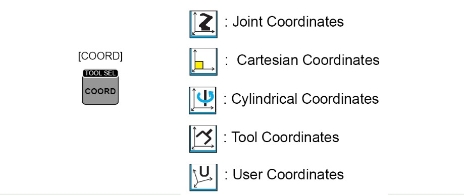
| Sistema de coordenadas | Función |
|---|---|
| **Joint** | Movimiento independiente de las seis articulaciones del robot. |
| **Cartesian** | Traslaciones y rotaciones respecto al sistema cartesiano del robot. |
| **Cylindrical** | Movimiento según coordenadas cilíndricas. |
| **Tool** | Movimiento respecto a los ejes locales de la herramienta. |
| **User** | Movimiento respecto a un sistema de coordenadas definido por el usuario. |

Para pasar de articulaciones a cartesiano, se pulsa COORD hasta que aparezca el símbolo de coordenadas cartesianas en la barra de estado. Para regresar, se repite la operación hasta seleccionar el símbolo de articulaciones.

## 3.3. Movimiento manual por articulaciones (JOINT)
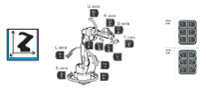

En este modo se controla directamente cada uno de los seis ejes articulares del Motoman MH6 los cuales están nombrados de la siguiente manera: S, L, U, R, B, T, 7 y 8.

### Procedimiento
1.	Mantener el controlador en TEACH.
2.	Pulsar COORD hasta visualizar el símbolo de articulaciones (Joint Coordinates).
3.	Seleccionar velocidad (ver punto 4).
4.	Mantener presionado el botón de hombre muerto en su posición intermedia.
5.	Presionar la tecla correspondiente a la articulación que se desea desplazar, en dirección positiva (+) o negativa (−).
6.	Soltar la tecla para detener el movimiento y repetir el procedimiento con las demás articulaciones.

| Articulación | Función | Teclas del Teach Pendant |
|---|---|---|
| **S (Swivel)** | Giro de la base | `X−/S−` y `X+/S+` |
| **L (Lower arm)** | Movimiento del brazo inferior | `Y−/L−` y `Y+/L+` |
| **U (Upper arm)** | Movimiento del brazo superior | `Z−/U−` y `Z+/U+` |
| **R (Roll)** | Giro de la muñeca | `X−/R−` y `X+/R+` |
| **B (Bend)** | Inclinación de la muñeca | `Y−/B−` y `Y+/B+` |
| **T (Twist)** | Giro del eje terminal | `Z−/T−` y `Z+/T+` |
| **7 (Prismática externa)** | Banda de desplazamiento robot | `Z−/T−` y `Z+/T+` |
| **8 (Rotacional externa)** | Giro de disco externo | `Z−/T−` y `Z+/T+` |

## 3.4. Movimiento manual en coordenadas cartesianas
El modo cartesiano permite controlar el movimiento del TCP utilizando un sistema de referencia con tres ejes ortogonales: X, Y y Z.
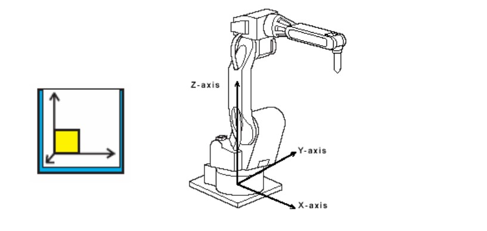

Procedimiento para cambiar de JOINT a CARTESIAN
1.	Detener cualquier movimiento soltando las teclas de los ejes.
2.	Presionar COORD hasta seleccionar el símbolo Cartesian Coordinates, representado por tres ejes con un cuadrado amarillo.
3.	Comprobar el icono seleccionado en la barra superior del TEACH.
4.	Utilizar las teclas correspondientes a traslación o rotación.

A diferencia del modo articular, en este sistema el controlador calcula las variaciones necesarias de las articulaciones para producir el movimiento cartesiano solicitado.

## 3.4.1. Movimientos de traslación
Para realizar desplazamientos lineales del TCP, se utiliza el primer grupo de teclas del TEACH.

| Teclas | Movimiento |
|---|---|
| `X+/S+` | Traslación en dirección X positiva. |
| `X−/S−` | Traslación en dirección X negativa. |
| `Y+/L+` | Traslación en dirección Y positiva. |
| `Y−/L−` | Traslación en dirección Y negativa. |
| `Z+/U+` | Traslación en dirección Z positiva. |
| `Z−/U−` | Traslación en dirección Z negativa. |

## 3.4.2. Movimientos de rotación
Para modificar la orientación del TCP, se utiliza el segundo grupo de teclas, correspondiente a los ejes de muñeca.

| Teclas | Movimiento |
|---|---|
| `X+/R+` | Rotación positiva alrededor del eje X. |
| `X−/R−` | Rotación negativa alrededor del eje X. |
| `Y+/B+` | Rotación positiva alrededor del eje Y. |
| `Y−/B−` | Rotación negativa alrededor del eje Y. |
| `Z+/T+` | Rotación positiva alrededor del eje Z. |
| `Z−/T−` | Rotación negativa alrededor del eje Z. |

En el movimiento cartesiano, las rotaciones permiten modificar la orientación de la herramienta respecto al sistema de referencia seleccionado. El sentido positivo de las rotaciones se interpreta mediante la regla de la mano derecha, tomando como referencia la dirección positiva del eje respectivo.
Es importante aclarar que, aunque las teclas están identificadas también con las articulaciones R, B y T, en modo cartesiano representan rotaciones respecto a los ejes X, Y y Z. El controlador puede movilizar varias articulaciones simultáneamente para producir la orientación deseada

## 4. Niveles de Velocidad 

### Selección de velocidad para movimientos manuales

El robot **Motoman MH6**, mediante su controlador **DX100**, permite ajustar la velocidad de desplazamiento durante la operación manual desde el *Teach Pendant*. 

El controlador dispone de **cuatro niveles de velocidad manual**, que permiten adaptar el movimiento del robot según la precisión y rapidez requeridas.

### 1. Niveles de velocidad manual

Los niveles disponibles son los siguientes:

| Nivel | Identificador | Descripción | Aplicación |
|---|:---:|---|---|
| **Inching** | `I` | Movimiento incremental de muy corta distancia por accionamiento de la tecla. | Ajustes finos y posicionamiento de alta precisión. |
| **Low Speed** | `L` | Movimiento continuo a baja velocidad mientras se mantiene presionada la tecla correspondiente. | Aproximación cuidadosa a piezas, herramientas u obstáculos. |
| **Medium Speed** | `M` | Movimiento continuo a velocidad intermedia. | Posicionamiento general y desplazamientos dentro del espacio de trabajo. |
| **High Speed** | `H` | Movimiento continuo a la velocidad manual más alta disponible. | Desplazamientos amplios en zonas libres de obstáculos. |

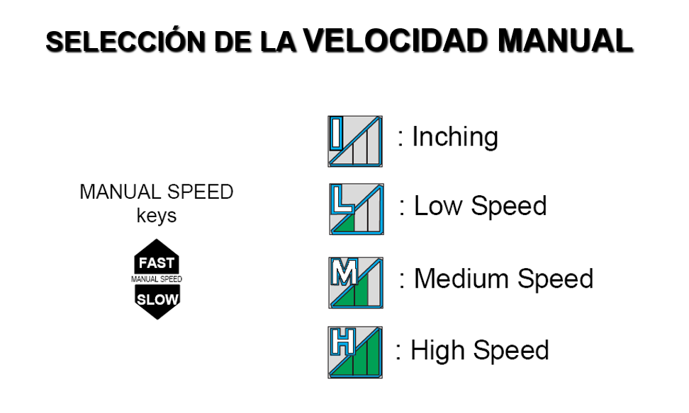

**Figura 1.** Niveles de velocidad manual y teclas de selección `FAST` y `SLOW` del controlador DX100.

#### Consideraciones importantes

- **Inching (I):** a diferencia de los otros niveles, está orientado a realizar pequeños incrementos de posición, lo que facilita el ajuste fino del manipulador.
- **Low (L):** permite realizar movimientos lentos y controlados, especialmente útiles cuando el robot se encuentra cerca de objetos.
- **Medium (M):** ofrece una velocidad intermedia para desplazamientos habituales durante la programación manual.
- **High (H):** permite efectuar desplazamientos manuales más rápidos, siempre respetando las restricciones de seguridad del controlador.

### 2. Procedimiento para cambiar el nivel de velocidad

La selección de velocidad manual se realiza directamente mediante las teclas **MANUAL SPEED**, ubicadas en el *Teach Pendant*.

Estas teclas están identificadas como:

- **FAST (▲):** aumenta el nivel de velocidad manual.
- **SLOW (▼):** disminuye el nivel de velocidad manual.

El procedimiento consiste en:

1. Colocar el controlador en modo **TEACH** para habilitar la operación manual.
2. Verificar el nivel de velocidad actualmente seleccionado en el área de estado de la pantalla.
3. Presionar la tecla `FAST` para aumentar la velocidad o `SLOW` para disminuirla.
4. Observar cómo cambia el indicador de velocidad en la interfaz.
5. Seleccionar el nivel apropiado antes de ejecutar cualquier movimiento manual mediante las teclas de desplazamiento de los ejes.

Durante la selección, el robot no necesita estar en movimiento; el cambio se refleja directamente en el indicador de velocidad del controlador.

### 3. Identificación de la velocidad en la interfaz

El controlador DX100 dispone de un **área de estado** ubicada en la parte superior de la pantalla del *Teach Pendant*. Esta sección muestra diferentes indicadores relacionados con el funcionamiento del robot.

Entre ellos se encuentra el indicador de **velocidad manual**, identificado con la letra `C` en el esquema de la Figura 2.

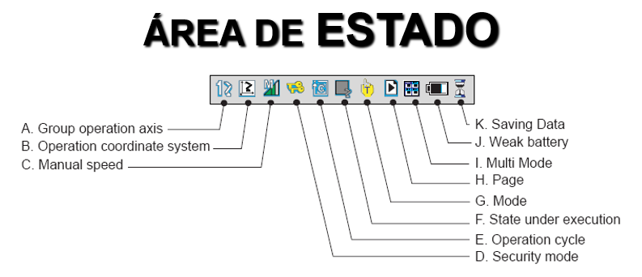

**Figura 2.** Área de estado del controlador DX100. El elemento `C` corresponde al indicador de velocidad manual.

El indicador muestra el nivel seleccionado mediante una letra.

De esta manera, el operador puede comprobar visualmente la velocidad configurada antes y durante la ejecución de movimientos manuales.

## 5. Funcionalidades de RoboDK y comunicación con el Motoman MH6

### 5.1. Descripción general de RoboDK

**RoboDK** es un software de simulación y programación de robots industriales que permite diseñar, visualizar, analizar y ejecutar trayectorias robóticas mediante un entorno virtual tridimensional.

Su principal característica es la **programación fuera de línea (Offline Programming)**, que permite desarrollar programas de movimiento sin necesidad de intervenir directamente sobre el manipulador físico.

Entre sus principales funcionalidades se encuentran:

- **Simulación 3D:** representación del manipulador y de su entorno de trabajo para visualizar los movimientos antes de ejecutarlos físicamente.
- **Control articular y cartesiano:** modificación de la posición y orientación del robot mediante sus articulaciones o mediante las coordenadas del efector final.
- **Programación de trayectorias:** creación de secuencias de movimientos articulares, lineales y circulares.
- **Cinemática robótica:** cálculo de las configuraciones articulares y de la posición y orientación del efector final.
- **Detección de colisiones:** identificación de posibles interferencias entre el manipulador y los objetos modelados en la estación, cuando se habilita esta funcionalidad.
- **Configuración de herramientas y referencias:** definición del TCP (*Tool Center Point*) y de los sistemas de coordenadas utilizados durante los movimientos.
- **Generación de programas:** conversión de las trayectorias simuladas al lenguaje de programación compatible con el controlador del robot.
- **Comunicación con robots físicos:** transferencia de programas y ejecución remota de movimientos mediante controladores y protocolos de comunicación compatibles.

Para el **Motoman MH6**, RoboDK permite desarrollar trayectorias en simulación y generar programas compatibles con el controlador **DX100**.

### 5.2. Programación del Motoman MH6 mediante Python

RoboDK dispone de una interfaz de programación de aplicaciones (**API**) que permite interactuar con el entorno de simulación utilizando lenguajes como Python.

En este proyecto se utiliza **Python junto con la API de RoboDK** para definir y automatizar los movimientos del manipulador Motoman MH6, permitiendo controlar las configuraciones articulares, establecer trayectorias y ejecutar secuencias de movimiento dentro del entorno virtual.

La API permite acceder a los elementos de la estación robótica y ejecutar instrucciones mediante código, sin depender exclusivamente de la interfaz gráfica del software.

Entre sus principales funciones se encuentran:

- **Selección del manipulador:** acceso al modelo del robot dentro de la estación.
- **Lectura de articulaciones:** obtención de los valores angulares de las seis articulaciones.
- **Movimientos articulares (`MoveJ`):** desplazamientos entre configuraciones articulares.
- **Movimientos lineales (`MoveL`):** desplazamientos cartesianos del TCP siguiendo una trayectoria rectilínea.
- **Configuración de herramientas:** selección del TCP y de los sistemas de referencia.
- **Automatización:** ejecución de secuencias de movimientos mediante scripts de Python.
- **Generación de programas:** utilización de postprocesadores para convertir las instrucciones a programas compatibles con el controlador Motoman.
- **Ejecución remota:** envío de instrucciones al robot físico mediante un Robot Driver compatible, cuando la comunicación está configurada.

#### Integración de Python con la programación offline y online

La programación mediante Python puede utilizarse tanto para simulación como para la ejecución de programas en el manipulador físico.

**Programación offline:**

1. Se definen los movimientos mediante instrucciones de Python.
2. La API transmite las instrucciones al entorno de RoboDK.
3. RoboDK simula los movimientos del manipulador.
4. Se utiliza un postprocesador para generar el programa Motoman en formato `.JBI`.
5. El archivo generado puede transferirse al controlador DX100.

**Programación online:**

1. Se establece una conexión entre RoboDK y el controlador DX100.
2. Se configura el Robot Driver correspondiente.
3. El script de Python ejecuta instrucciones mediante la API.
4. RoboDK envía los comandos al controlador.
5. El DX100 ejecuta los movimientos sobre el manipulador físico.

Por lo tanto, Python constituye la interfaz utilizada para desarrollar las instrucciones, mientras que RoboDK proporciona la simulación, la generación de programas y los mecanismos de comunicación con el robot industrial.

### 5.2. Comunicación entre RoboDK y el Motoman MH6

La comunicación entre RoboDK y el manipulador se realiza a través del controlador **DX100**, el cual interpreta las instrucciones de movimiento y gobierna los servomotores del robot.

RoboDK dispone de dos métodos principales para trabajar con el manipulador físico:

#### 5.2.1. Programación offline mediante postprocesador

En este procedimiento, las trayectorias se desarrollan inicialmente dentro del entorno de simulación. Una vez verificadas, RoboDK utiliza un **postprocesador (Post Processor)** para convertir las instrucciones del programa al formato requerido por el controlador.

Para los manipuladores Yaskawa Motoman, los programas pueden generarse como archivos **`.JBI`**, correspondientes al lenguaje de programación **INFORM**.

El procedimiento general consiste en:

1. Seleccionar el modelo Motoman MH6 dentro de RoboDK.
2. Configurar los sistemas de referencia y la herramienta utilizada.
3. Definir los puntos y las trayectorias que debe recorrer el manipulador.
4. Establecer los tipos de movimiento y sus velocidades.
5. Simular la secuencia y verificar que las posiciones sean alcanzables y que no se presenten colisiones detectables en el modelo.
6. Seleccionar el postprocesador compatible con Yaskawa Motoman.
7. Generar el archivo del programa mediante la opción **Generate Robot Program (F6)**.
8. Transferir el archivo generado al controlador DX100 mediante un mecanismo compatible, como FTP o una memoria USB.
9. Verificar el programa recibido y ejecutarlo desde el controlador bajo las condiciones de operación y seguridad correspondientes.

En este método, **RoboDK genera el programa, mientras que el controlador DX100 se encarga de interpretar y ejecutar las instrucciones del manipulador**.

#### 5.2.2. Programación online mediante Robot Driver

RoboDK también permite establecer una comunicación directa con el robot mediante un **Robot Driver**, evitando la necesidad de generar y transferir previamente un archivo completo para cada secuencia de movimientos.

Para los controladores Motoman compatibles se encuentra disponible el driver **MotomanHSE**, que utiliza el protocolo *High-Speed Ethernet Server (HSE)* mediante una conexión de red Ethernet (TCP/IP y UDP).

Este mecanismo permite enviar instrucciones desde RoboDK al controlador y consultar información del estado del robot.

En el caso del **DX100**, la documentación indica que se requiere una versión de firmware **2.7.00 o superior** para utilizar este driver, además de habilitar el modo remoto (*Remote*) en el controlador.

El procedimiento general de conexión es:

1. Establecer una conexión Ethernet entre el computador y el controlador DX100.
2. Verificar que ambos dispositivos tengan una configuración de red compatible.
3. Abrir la estación del Motoman MH6 en RoboDK.
4. Seleccionar el robot y acceder a **Connect to robot**.
5. Introducir la dirección IP del controlador.
6. Verificar que esté seleccionado el driver **MotomanHSE**.
7. Habilitar el modo remoto en el controlador, siguiendo las condiciones de seguridad establecidas.
8. Seleccionar **Connect** para establecer la comunicación.
9. Utilizar la opción **Run on Robot** para ejecutar las instrucciones desde RoboDK, una vez verificadas las condiciones de operación.

Durante este procedimiento, RoboDK envía las instrucciones de movimiento al controlador, que se encarga de ejecutarlas sobre los actuadores del manipulador.

**Nota:** La disponibilidad de este método depende de la versión del firmware, la configuración del controlador y los permisos de operación habilitados en el laboratorio.

### 5.3. Proceso de transferencia de programas al controlador DX100

La transferencia de programas permite enviar al controlador físico las instrucciones previamente generadas mediante el postprocesador de RoboDK.

De acuerdo con la documentación oficial, este procedimiento puede realizarse mediante FTP u otros mecanismos compatibles.

Para realizar la transferencia desde RoboDK se sigue el procedimiento:

1. Hacer clic derecho sobre el modelo del robot.
2. Seleccionar **Connect to robot**.
3. Introducir la dirección IP del controlador DX100.
4. Seleccionar **More options** y configurar los parámetros FTP, incluidas las credenciales y la ruta de destino, cuando sean necesarias.
5. Utilizar **Ping** para comprobar la accesibilidad del controlador en la red.
6. Hacer clic derecho sobre el programa que se desea transferir.
7. Seleccionar **Send Program to Robot (Ctrl + F6)**.
8. Verificar el mensaje de confirmación o error de la transferencia.

Es importante aclarar que **la transferencia de un archivo no implica su ejecución inmediata**. El programa debe encontrarse correctamente almacenado en el controlador y debe ejecutarse conforme al procedimiento de operación correspondiente.

Además, la transferencia puede realizarse sin activar el driver utilizado para el control online, puesto que ambos mecanismos cumplen funciones diferentes.

### 5.4. Procesamiento de los movimientos del manipulador

El proceso que permite llevar una trayectoria diseñada en RoboDK hasta el movimiento físico del Motoman MH6 puede describirse mediante las siguientes etapas:

1. **Definición de objetivos:** se establecen las posiciones articulares o las posiciones y orientaciones cartesianas deseadas para el efector final.
2. **Cálculo cinemático:** RoboDK determina las configuraciones articulares asociadas a los objetivos y considera las restricciones geométricas del modelo.
3. **Simulación:** se representa el desplazamiento del manipulador para analizar la trayectoria y detectar posibles problemas.
4. **Preparación de instrucciones:** las trayectorias se convierten en programas compatibles con Motoman mediante un postprocesador, o se preparan para su envío mediante el driver.
5. **Comunicación:** las instrucciones se transfieren al controlador DX100 mediante el mecanismo seleccionado.
6. **Ejecución:** el DX100 interpreta las instrucciones y gobierna los servomotores para producir el movimiento físico del manipulador.

En los programas Motoman, las posiciones articulares también pueden representarse mediante pulsos de los encoders. Por este motivo, es importante que RoboDK disponga de la relación correcta entre pulsos y grados para cada articulación, información que puede obtenerse de los parámetros del controlador.

### 5.5. Comparación entre programación offline y online

| Característica | Programación offline | Programación online |
|---|---|---|
| Herramienta principal | Postprocesador | Robot Driver |
| Desarrollo de trayectorias | En RoboDK | En RoboDK |
| Archivo de programa | Se genera `.JBI` | No es necesario generar previamente el archivo |
| Comunicación | Transferencia de archivos | Envío de instrucciones mediante HSE |
| Ejecución | Gestionada por el DX100 | Ordenada desde RoboDK y ejecutada por el DX100 |
| Aplicación principal | Rutinas y trayectorias previamente definidas | Pruebas, depuración y control remoto |

### 5.6. Consideraciones para la ejecución en el laboratorio

Antes de ejecutar movimientos físicos deben verificarse los límites articulares, la configuración inicial, la calibración del TCP, los sistemas de referencia y las posibles interferencias con el entorno.

También debe comprobarse que los parámetros del modelo virtual correspondan con los del manipulador físico.

La simulación permite identificar posibles errores antes de la ejecución, pero no reemplaza los procedimientos de seguridad del fabricante ni garantiza por sí sola que una trayectoria sea segura.

### 5.7. Diagrama de Comunicación 

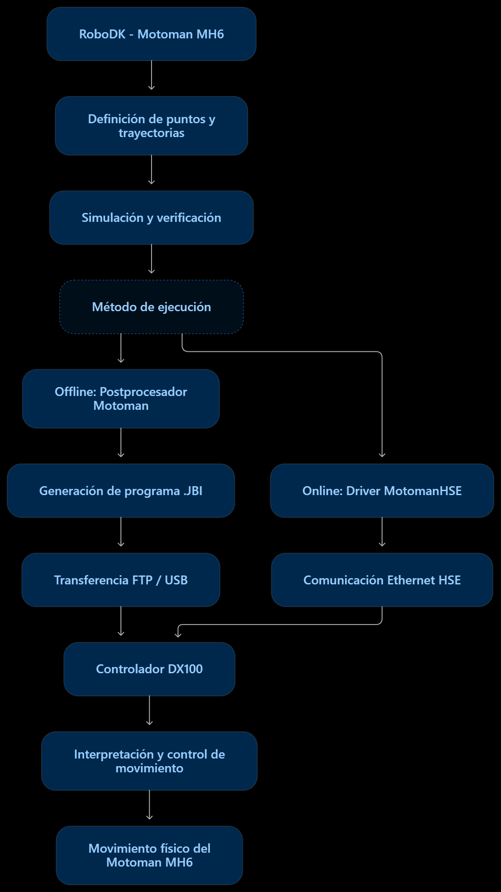

## 6. ROBOTDK vs RobotStudio

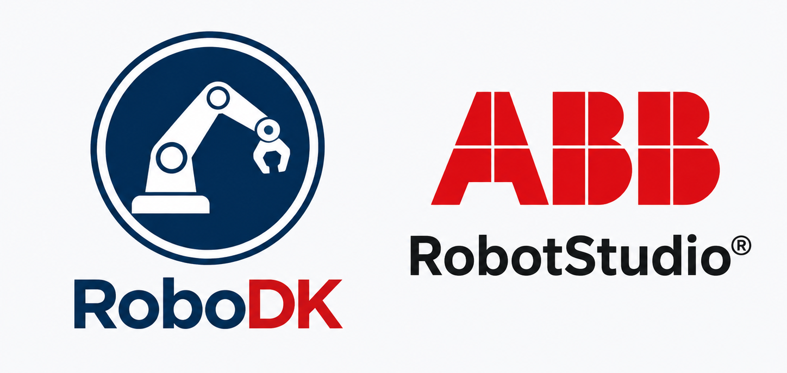

RoboDK y RobotStudio son herramientas orientadas a la simulación, programación y análisis de sistemas robóticos industriales. Ambas permiten desarrollar y evaluar movimientos en entornos virtuales antes de implementarlos sobre manipuladores físicos, mediante un enfoque de programación fuera de línea (Offline Programming, OLP).

Sin embargo, sus enfoques son diferentes. RoboDK se caracteriza por su compatibilidad con robots de múltiples fabricantes y por ofrecer una interfaz de programación flexible mediante lenguajes como Python. Por otra parte, RobotStudio está especializado en el ecosistema ABB y destaca por incorporar un controlador virtual que ejecuta el software de control utilizado en sus robots reales, permitiendo evaluar programas RAPID, señales de entrada y salida y comportamientos de una celda automatizada.

## 6.1. Comparación de características

| Característica | RoboDK | RobotStudio |
|---|---|---|
| **Fabricante** | RoboDK | ABB Robotics |
| **Compatibilidad** | Robots de múltiples fabricantes, como Yaskawa Motoman, ABB, FANUC, KUKA y UR. | Especializado en robots y controladores ABB. |
| **Enfoque principal** | Simulación y programación de trayectorias industriales multimarca. | Simulación, programación y puesta en servicio virtual de sistemas ABB. |
| **Programación** | Interfaz gráfica y API con Python, C#, C++, MATLAB, entre otros. | Lenguaje RAPID y herramientas de programación propias de ABB. |
| **Simulación** | Modelos cinemáticos, trayectorias, herramientas, objetos y detección de colisiones. | Simulación de movimientos, lógica de control, señales y procesos de automatización. |
| **Controlador virtual** | Simula movimientos y genera código mediante postprocesadores, sin emular íntegramente el controlador de cada fabricante. | Utiliza ABB Virtual Controller, que ejecuta el software del controlador ABB. |
| **Entradas y salidas** | Permite integrar instrucciones y lógica mediante su API y funciones compatibles con el controlador. | Integra señales de E/S, instrucciones RAPID y Smart Components para simular procesos. |
| **Conexión física** | Transferencia de programas y control mediante drivers compatibles. | Comunicación y configuración de controladores ABB reales. |
| **Aplicación destacada** | Trayectorias, mecanizado robotizado, fabricación aditiva y aplicaciones multimarca. | Celdas industriales ABB, secuencias automatizadas, sistemas periféricos y puesta en marcha virtual. |

## 6.2. Ventajas y limitaciones
## 6.2.1. RoboDK
Su principal ventaja es la flexibilidad para trabajar con diferentes fabricantes sin depender de un único lenguaje de programación. Mediante su API se pueden automatizar movimientos, crear trayectorias, realizar cálculos de posiciones y generar programas para controladores específicos utilizando postprocesadores.
Esta característica resulta especialmente útil en entornos académicos y de investigación, donde es frecuente trabajar con diferentes manipuladores y desarrollar algoritmos propios.
Su principal limitación es que la simulación no reproduce necesariamente todos los aspectos internos del controlador físico. La generación y ejecución de programas dependen de la compatibilidad del postprocesador, del driver utilizado y de las funciones disponibles en el controlador real.
Además, aunque es posible verificar trayectorias y detectar colisiones, la precisión de los resultados depende de la correspondencia entre el modelo virtual y el sistema físico, incluyendo geometrías, herramientas, sistemas de referencia y calibración

## 6.2.2. RobotStudio
La principal ventaja de RobotStudio es su integración con el entorno de programación y control de ABB. A diferencia de un simulador principalmente cinemático, utiliza un controlador virtual capaz de ejecutar software de control ABB, permitiendo comprobar el comportamiento de programas RAPID y su interacción con elementos de una celda automatizada.
Los Smart Components amplían estas posibilidades, pues permiten representar comportamientos de dispositivos periféricos mediante propiedades, señales y conexiones lógicas. De esta manera, pueden desarrollarse simulaciones de bandas transportadoras, actuadores, sensores y secuencias de producción coordinadas con el manipulador.
Su principal limitación es la dependencia del ecosistema ABB. Aunque pueden incorporarse modelos de otros fabricantes como elementos gráficos, la programación y simulación mediante el controlador virtual están orientadas a los sistemas ABB. Esto reduce su conveniencia para proyectos cuyo objetivo principal sea programar directamente manipuladores de otros fabricantes, como Yaskawa Motoman

# 6.3. Consideraciones del equipo alrededor de ambas herramientas
A partir de la experiencia adquirida durante el desarrollo de las prácticas, consideramos que ambas herramientas ofrecen ventajas importantes, aunque presentan enfoques diferentes. RoboDK nos pareció una plataforma más intuitiva y accesible, especialmente para la creación y simulación de trayectorias. Además, su integración con Python representa una de sus características más interesantes, ya que permite parametrizar movimientos, generar trayectorias mediante expresiones matemáticas y desarrollar algoritmos personalizados, ofreciendo mayor flexibilidad para experimentar con diferentes soluciones.

Por otra parte, RobotStudio nos dio la impresión de ser una herramienta más completa y especializada, principalmente por su integración con los controladores ABB, la programación RAPID y las posibilidades de simular procesos automatizados mediante señales digitales y Smart Components. Aunque su curva de aprendizaje puede ser mayor, consideramos que ofrece un entorno más estructurado para desarrollar aplicaciones industriales que requieren la coordinación de diferentes dispositivos.

En cuanto a su presentación e interfaz, percibimos que RoboDK tiene una apariencia más sencilla y menos sofisticada que RobotStudio. Sin embargo, esto no representa necesariamente una desventaja, pues facilita su manejo y permite concentrarse en la programación del manipulador. Asimismo, nos parece especialmente interesante su compatibilidad con robots de diferentes fabricantes, ya que amplía considerablemente las posibilidades de aplicación sin depender de un único ecosistema.

## 7. Diagrama de Flujo

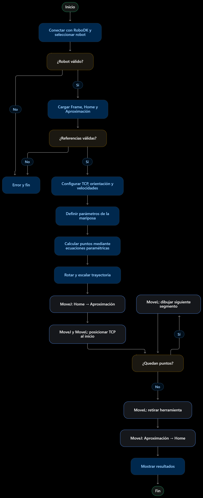

  

## 8. Plano de Planta
## 9. Rutina
### Referencias

1. Yaskawa Motoman. *MOTOMAN-MH6 Instructions*. Manual de especificaciones y operación del manipulador.
2. Yaskawa Motoman. *MH6/MH6S Technical Specifications*.
3. ABB Robotics. *Product Manual - IRB 140*. Documento 3HAC027400-001, revisión AA, 2024.
4. ABB Robotics. *Product Specification - IRB 140*. Documento 3HAC041346-001.
5. Yaskawa Motoman. *DX100 - Manual de instrucciones y programación básica*.
6. RoboDK. [Robot Programs – Documentación oficial](https://robodk.com/doc/en/Robot-Programs.html).
7. RoboDK. [Transfer Program](https://robodk.com/doc/en/Robot-Programs-Transfer-Program.html).
8. RoboDK. [Yaskawa Motoman Robots](https://robodk.com/doc/en/Robots-Motoman.html).
9. RoboDK. [RoboDK Driver for Yaskawa Motoman](https://robodk.com/doc/en/Robots-Motoman-RoboDK-driver-Yaskawa-Motoman.html).
10. RoboDK. [RoboDK – Python API](https://robodk.com/doc/en/RoboDK-API-Python-API.html).
